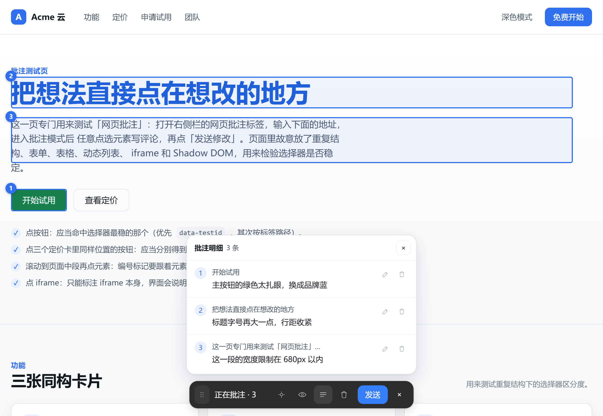
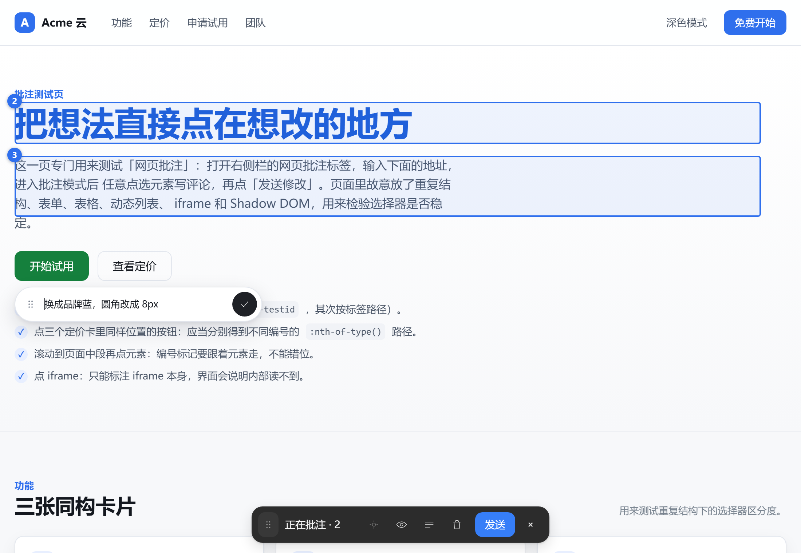
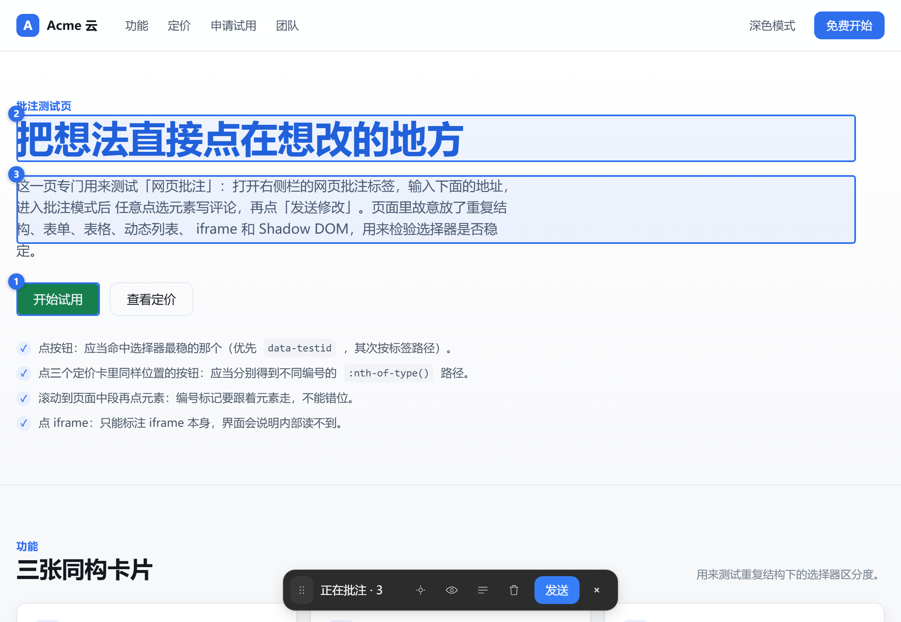

# 网页批注 / Web Annotations

在 DSH 内置浏览器里打开网页，**点选页面元素写评论**，再一次性把「页面地址 + 元素定位 + 你的批注」发给当前会话，让模型直接在项目源码里找到对应位置并修改。

这是 Codex / Qoder 那种「可视化批注 → 一次发送 → 改代码」的流程，落在 DSH 自己的右侧栏里。

## 界面

点选元素后，评论框浮现在它旁边；已收集的批注在页面上留下编号和高亮框，底部是一条深色功能栏：



评论框是胶囊形输入条，左缘与元素对齐，按住左侧六点手柄可以拖走：



攒够之后点功能栏的「发送」，整批一次性发给会话：



## 它解决什么

对着截图或口头描述说「把这个按钮改蓝一点」，模型只能猜是哪个按钮。批注把「哪个元素」变成可核对的定位信息：选择器、可见文本、DOM 路径、标签名，必要时还有 HTML 片段。

你只需要做一件事：在页面上点一下，写一句话。

## 入口：就是原来的「浏览器」

插件以 extension 优先级**接管了出厂的 `browser` 标签类型**，所以没有单独的入口：

- 右侧栏引导页里的 **浏览器** 卡片（`Ctrl + T`）打开的就是带批注的浏览器；
- 聊天里的链接选「在内置浏览器打开」，以及 `sidebarRight.openTab('browser')` 打开的标签，都落到同一个实现；
- 卡片图标是「地球 + 评论气泡」。

移除本插件后，出厂浏览器原样恢复。

## 用法

1. 右侧栏点 `+` → **浏览器**（或 `Ctrl + T`）。
2. 地址栏输入页面地址。不带协议时，本机/内网默认 `http`，其余默认 `https`。
3. 点工具栏的批注按钮（气泡+笔图标）进入**批注模式**：鼠标划过元素出现蓝色高亮，点击即选中。
4. 评论框浮现在元素旁边，是一个胶囊形输入条：左侧六点拖动手柄 + 中部输入框 + 右侧圆形确认按钮。
   按住手柄可以拖到任意位置；换一个元素重新点选时，评论框回到新元素旁边。
5. 写完点 **✓**（或 `Ctrl/Cmd + Enter`）：**只添加这一条，并立刻回到拾取状态**。
6. **连续批注**：一条加完直接点下一个元素，不用再点工具栏按钮，也不会中途发出去。
7. 攒够之后，点悬浮功能栏的蓝色「发送」一次性发整批。

## 悬浮功能栏

批注控制集中在网页视口底部的一条深色胶囊里，宽度随内容收紧：

```
[拖动柄] 正在批注 · 2  [暂停/继续] [标记显隐] [明细] [清空] [发送] [×]
```

| 按钮 | 行为 |
|---|---|
| 拖动柄 | 移动整条功能栏，始终夹在视口内；`Home` 恢复默认位置。拖动不会触发页面拾取。 |
| 状态文案 | 显示已收集条数；暂停时为「批注已暂停 · 2」。 |
| 暂停/继续 | 暂停后可以正常操作网页，已收集批注保留；继续恢复悬停与点选。 |
| 标记显隐 | 只切换网页上的编号与批注边框，条目和发送都不受影响；导航与重新注入后仍保持该状态。 |
| 明细 | 在功能栏旁打开抽屉，逐条查看 / 编辑 / 删除。默认与功能栏居中对齐；拖动功能栏后跟随其左缘并夹在视口内；拖到视口上半部时抽屉翻到下方。 |
| 清空 | 清掉全部已收集批注与未保存输入。 |
| 发送 | 唯一的整批发送入口。**未保存的输入会先加入本次批次**，只提交一次。 |
| × | 退出模式并隐藏功能栏，**保留**已收集批注与未保存输入。 |

新增批注只更新数量，不会自动展开抽屉。编辑一条批注时就地展开输入框，只有一个蓝色「保存」按钮，取消用 `Esc`。

`Esc` 按由内到外逐层退出：行内编辑 → 明细抽屉 → 退出批注模式。焦点在输入框里时 `Esc` 交给输入框自己处理，不会丢正在写的字。

窄视口（≤520px）下状态文案缩短为「批注 · 2」并收紧间距，320px 不横向溢出。
所有图标都有 `title` 与 `aria-label`，开关带 `aria-pressed`，明细带 `aria-expanded`。过渡约 120ms 并尊重 `prefers-reduced-motion`。

## 发送出去是什么样

会话里出现一张可折叠的**批注卡片**，而不是一大段 Markdown：

```
┌ 网页批注  3 条  ─────────────────┐
│ 1  把主按钮文案改成「开始试用」      │
│ 2  这里的圆角再小一点               │
│ 3  表格列宽不对                    │
└──────────────────────────────────┘
```

模型收到的是完整文本，卡片只是它的折叠视图。展开后能看到每一条的定位信息。

卡片由消息文本本身解析出来，没有旁表：重开历史时会从同一段文字重新解析，不会出现「卡片和内容对不上」。

发送成功后只移除**本次提交的那几条**，之后新收集的批注保留并重新编号。发送期间会暂停拾取，避免新条目混进正在提交的批次。

## 安装

插件通过 `dsh.bundle` 清单安装：

```sh
dsh plugin add github:uugvkbvkdjbsdbvwxxl/dsh-plugin-web-annotate
```

或从本地目录安装：

```sh
dsh plugin add /path/to/dsh-plugin-web-annotate
```

安装后刷新桌面窗口（`Ctrl + R`）加载客户端包。

## 能力边界

以下是有意为之，不是遗漏：

- **不读取跨源 iframe 内部**。浏览器安全模型不允许，页内脚本只在顶层文档与同源 frame 上工作。
- **不写会话输入框**。批注以一次消息提交的形式进入会话，而不是塞进 composer 当草稿。宿主没有提供向 composer 写入草稿的服务，插件不绕过这个边界。
- **不修改被访问的页面**。页内只有一个 Shadow DOM 覆盖层用于高亮与编号，样式通过 CSSOM 注入（严格的 `style-src` CSP 下 `<style>` 会被拒绝）。
- **不持久化批注列表**。刷新页面后已收集的批注不保留；发送后的卡片仍在会话历史里。

## 文件

| 文件 | 作用 |
|---|---|
| `package.json` | bundle 清单：`dsh.bundle.patch` + `dsh.client`（`platform: web`） |
| `cordis.patch.yml` | 插入 Host 行；所有行为在 Client 半 |
| `index.js` | Host 半，空实现（本功能不需要 Host 工具） |
| `client.js` | 浏览器类型接管、webview guest、页内拾取脚本、功能栏、发送 |
| `locale/en.json` / `locale/zh.json` | 插件元数据与全部界面文案 |
| `icon.svg` | 图标（地球 + 评论气泡） |

## 许可

MIT
